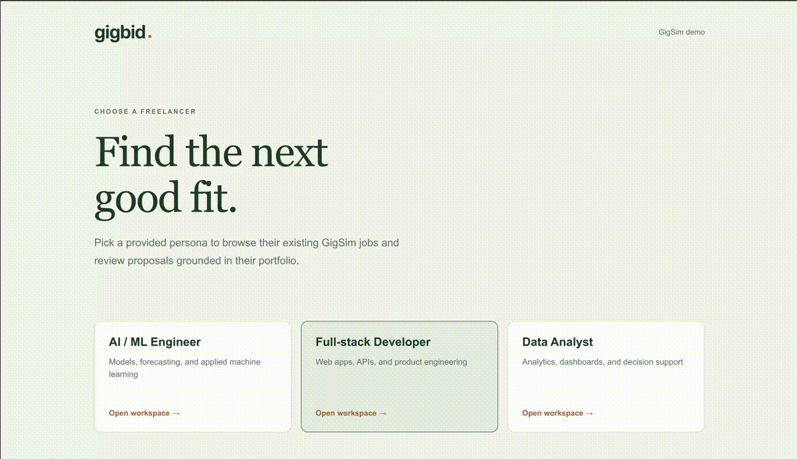

# GigBid

GigBid is a freelancer copilot for discovering freelance jobs, assessing fit and
risk, finding supporting portfolio evidence, and drafting grounded proposals.
It also supports client conversations and review workflows. External actions are
always subject to explicit human approval.

GigSim is the local marketplace simulator used for development and evaluation.
GigBid accesses marketplace and portfolio capabilities through authenticated MCP
services rather than scraping or direct marketplace calls.

## Features

- Job discovery, risk assessment, skill matching, pricing, and proposal drafting
- Portfolio-grounded retrieval and claim verification
- Five evaluated RAG variants: V0, V1, V2, V3, and V8
- LangGraph bid and conversation workflows with durable checkpoints
- Authenticated Portfolio, Marketplace, and Workspace MCP services
- Next.js review workspace with approval-gated proposals and messages
- GigSim marketplace, client history, Connects, proposals, messages, and replies
- Local development stack using Postgres, Redis, Chroma, Ollama, and an Arq worker

## Architecture

~~~
Next.js web app
        │
        ▼
FastAPI API ──► LangGraph bid/conversation workflows ──► MCP services
        │                                      ├─ Portfolio
        ├─ Postgres                            ├─ Marketplace → GigSim
        ├─ Redis                               └─ Workspace
        └─ Arq worker

RAG pipeline: portfolio ingestion → Chroma retrieval → reranking/verification
~~~

The main implementation areas are:

- `apps/web`: Next.js and TypeScript review interface
- `apps/api`: FastAPI API and orchestration endpoints
- `agent`: graph state, nodes, prompts, memory, and model routing
- `rag`: ingestion, retrieval variants, ranking, and claim verification
- `mcp_servers`: authenticated Portfolio, Marketplace, and Workspace services
- `gigsim`: local marketplace simulator
- `worker`: background job execution

See [the architecture guide](docs/ARCHITECTURE.md) for service boundaries and
[the orchestration guide](docs/ORCHESTRATION.md) for graph execution, approvals,
replay, and recovery.

## Requirements

- Docker Engine with Docker Compose
- [uv](https://docs.astral.sh/uv/)
- Node.js 22 and npm for host-side web commands
- Ollama with the configured local models for RAG and model-backed workflows

## Quick start

From the repository root:

~~~bash
cp .env.example .env
uv sync --frozen --extra dev
make dev
~~~

Open:

- Web workspace: <http://localhost:3000>
- API documentation: <http://localhost:8000/docs>

The Compose stack starts the API, web app, worker, databases, Redis, Chroma,
GigSim, and the Ollama bridge. Add local secrets and tokens from `.env.example`;
never commit `.env`.

For the complete setup sequence, migrations, ports, health checks, MCP
bootstrap, and troubleshooting, see the [runbook](docs/RUNBOOK.md).

## Development commands

~~~bash
make test           # unit and isolated tests
make lint           # Ruff checks and formatting checks
make worker-smoke   # verify separate worker execution through Redis
make web-install    # install frontend dependencies
make web-check      # typecheck and build the web app
make api-client     # regenerate the typed API client
make migrate        # apply database migrations
make mcp-bootstrap  # provision local MCP users and credentials
make mcp-smoke      # exercise MCP services
make down           # stop services and preserve volumes
~~~

GigSim data is seeded explicitly. After preparing processed data, use:

~~~bash
make seed
~~~

See [the GigSim README](gigsim/README.md) for simulator data and API details.

## RAG pipeline

The RAG pipeline ingests portfolio documents into a local Chroma index, retrieves
evidence using multiple strategies, optionally reranks candidates, and verifies
proposal claims through the Portfolio MCP service. Models, retrieval parameters,
and the active variant are configured in `agent/config.yaml`; prompts are stored
in `agent/prompts/`.

~~~bash
make rag-models       # prepare local embedding/reranker models
make rag-ingest       # ingest portfolio data into the local index
make rag-repair-data  # prepare coherent evaluation fixtures
~~~

The full RAG setup and evaluation procedure is documented in
[docs/RUNBOOK.md](docs/RUNBOOK.md) and [docs/RAG_EXPERIMENT.md](docs/RAG_EXPERIMENT.md).

<!-- B3_B5_START -->
## Evaluation

Run the complete benchmark with:

~~~bash
make rag-eval       # expensive: retrieval, drafting, verification, judging, outcomes, ablation
make rag-table      # offline: regenerate committed summaries and this table
make rag-calibrate  # import human scores and regenerate calibrated results
~~~

The committed comparison below is the published `rag-eval` summary. Judge
scores are provisional and hardware cost is not measured.

| Variant | Evidence Recall@5 | nDCG@10 | Unsupported claims per proposal | Judge score | GigSim reply rate | p95 latency (s) | Cost per proposal (USD) |
| --- | --- | --- | --- | --- | --- | --- | --- |
| v0 | 0.815 | 0.738 | 0.000 | 3.692 | 0.000 | 119.263 | not measured |
| v1 | 0.704 | 0.625 | 0.000 | 3.857 | 0.000 | 151.708 | not measured |
| v2 | 0.907 | 0.869 | 0.000 | 3.375 | 0.000 | 118.413 | not measured |
| v3 | 0.944 | 0.914 | 0.000 | 3.571 | 0.000 | 125.371 | not measured |
| v8 | 0.815 | 0.787 | 0.000 | 3.714 | 0.000 | 245.830 | not measured |

The full report and machine-readable results are committed in
[evals/results/](evals/results/README.md):

- [Full RAG report](evals/results/rag_comparison.md)
- [CSV comparison](evals/results/rag_comparison.csv)
- [JSON summary](evals/results/rag_comparison.json)

Raw timestamped runs are generated locally by `rag-eval`; they are not required
to understand or reproduce the published summary. See the results README for
artifact provenance and resume instructions.
<!-- B3_B5_END -->

## Safety and operating rules

- Human approval is required before sending proposals or messages.
- Claims in proposals must be grounded in portfolio evidence.
- Job posts, client messages, and other marketplace text are untrusted input.
- Marketplace access goes through MCP services; the project does not scrape.
- Secrets, local databases, generated corpora, and model caches stay out of Git.
- Policy and prompt behavior live in `data/policy_pack/`, `agent/config.yaml`,
  and `agent/prompts/` rather than being hidden in application code.

## Documentation

- [Getting started](docs/GETTING_STARTED.md)
- [Runbook](docs/RUNBOOK.md)
- [Architecture](docs/ARCHITECTURE.md)
- [Orchestration and approvals](docs/ORCHESTRATION.md)
- [MCP tool inventory](docs/TOOLS.md)
- [RAG experiment protocol](docs/RAG_EXPERIMENT.md)
- [GigSim](gigsim/README.md)
- [Data card](docs/DATA_CARD.md)
- [AI usage disclosure](docs/AI_USAGE.md)
