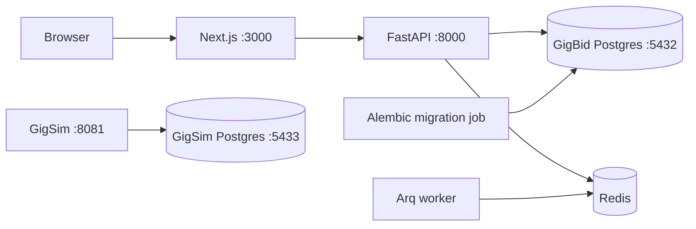

# Architecture

## Running foundation

Chroma (:8001 on the host) and Ollama (:11434) run alongside these services.
They are not prerequisites for infrastructure readiness. No models are pulled
at startup. The web renders on every request and uses the generated OpenAPI
contract to check `/ready`. `/health` checks process liveness only; `/ready`
checks GigBid Postgres and Redis with bounded timeouts and returns 503 on failure.

Arq consumes a harmless smoke task; no scouting, graph, or external sends run yet.
Alembic runs once before API/worker startup. Tables are users, jobs, proposals,
messages, pipeline_cards, and audit_log. UUID strings identify app records;
marketplace/external identifiers identify imported records. Monetary prices use
fixed precision. Audit entries have user and trace identifiers; append-only write
access and PII masking will be enforced by the tool layer, which is not built yet.

## Required target architecture

The bid graph uses Scout → parallel Job Analyst / Risk Assessor / Fit Matcher →
decision → Pricing → Writer → claim verification → Critic (at most two revisions)
→ Compliance → durable human interrupt → marketplace write through MCP.
The conversation graph classifies messages, drafts replies/slots, and uses the
same approval discipline. User edits must be rechecked before sending.

Agents access capabilities through MCP only. One marketplace port provides GigSim access; Portfolio and Workspace have
their own servers. Upwork is excluded by project choice. A third-party GitHub
MCP integration is deferred. Step 2 adds the
three owned MCP containers. No agent may access simulator tables directly.

Postgres-backed graph checkpoints, execution traces, and promoted long-term
style/outcome memories remain distinct. Future authentication scopes every
business query by user; OAuth tokens must be encrypted per user. No business
records are exposed by Step 1 endpoints.

## Simulator boundary

The existing `gigsim/` is preserved. It supplies auth, job/client APIs, proposal
and message APIs, Connects accounting, rate limiting, chaos errors, stream
release, and delayed rule-based replies. Its schema and data are independent
of GigBid. Existing SQLite tests do not prove PostgreSQL concurrency behavior.

## Existing host model

The user already runs Ollama with `qwen2.5:3b`. The `ollama` Compose service
is a Linux host-network TCP bridge to that service, using the existing Python
image instead of downloading a duplicate Ollama image/model. Containers reach
it through `host.docker.internal:11435`. Host Ollama stays bound to loopback.

## Step 2 MCP boundary

Portfolio (:8101), Marketplace (:8102), and Workspace (:8103) are separate
Streamable HTTP services. They share GigBid Postgres for credential hashes,
audit, write receipts, approval grants, and local artifacts. Marketplace alone
uses Redis for the shared upstream request quota and calls GigSim through its
adapter. Persona files are read-only mounts accessible only to Portfolio.
Agents use `MCPGateway` role allowlists and the MCP-backed marketplace port.

Upwork is intentionally excluded; GitHub is deferred. Workspace is local-only.
Lexical portfolio search precedes evaluated RAG. MCP tools cannot issue approvals;
proposal/message sends remain blocked until the later UI/graph issues grants.
Audit rows are append-only in Postgres; simulator write receipts are in its own DB.
